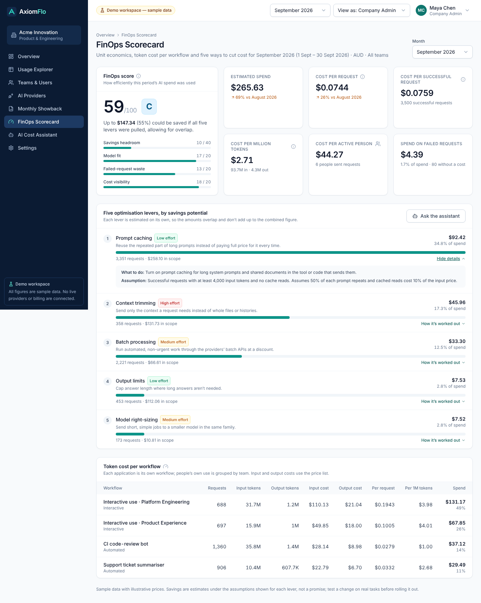
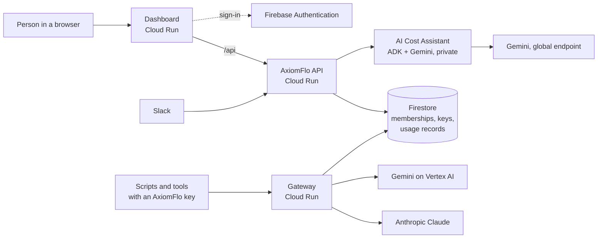

# AxiomFlo

**AxiomFlo shows a company where its AI money goes.** It records every Claude and Gemini request people make, works out what each one cost, and shows it by team, person, provider and model. A Gemini-powered **AI Cost Assistant** answers questions about that spend in plain English, on the web and in Slack, and only ever shows each person what they're allowed to see. A **FinOps Scorecard** grades how efficiently the money was spent and ranks five ways to spend less.

This repository is the working pilot, built for one company and running on Google Cloud.

**Live app:** https://axiomflo-603572706266.asia-southeast1.run.app

## Try it

- **No login needed:** on the sign-in page, click **Explore the demo workspace**. It opens a sample company (Acme Innovation) with about 6,000 generated requests, clearly labelled as sample data. Use **View as** in the top bar to switch between a Company Admin and an Individual User. Open **FinOps Scorecard** in the sidebar, or ask the AI Cost Assistant "How can we cut our AI costs?".
- **Real workspace, view-only:** on the sign-in page, click **Sign in as judge**, or enter these under **Work email** and **Password**:

  ```
  Email:    judge@acme.example
  Password: UibJQF92bwyAM9fnnswf
  ```

  It opens the live workspace with the same data the Company Admin sees. It can open every page, export showback and ask the AI Cost Assistant, but it can't change anything or spend money. How it's created: [docs/backend/view-only-login.md](docs/backend/view-only-login.md).

  > **This password is published on purpose.** It's a demo credential for a view-only account, not a secret, so secret scanners can ignore it. It will be reset after judging.

## What's built

| Part | What it does | Where |
| --- | --- | --- |
| **Dashboard** | Overview, Usage Explorer, Teams & Users, AI Providers, Monthly Showback (with CSV export), FinOps Scorecard, AI Cost Assistant and Settings. React + TypeScript, served by nginx on **Cloud Run**. | `src/` |
| **Sign-in and access** | **Firebase Authentication** with Google or email and password. Signing in only proves who you are; what you can see comes from a membership record in **Firestore**, checked by the API on every request. Company Admins invite people and manage roles. | `src/auth/`, `server/src/membership/` |
| **AxiomFlo API** | Node.js + Express on Cloud Run. Verifies Firebase sign-in tokens, enforces roles and teams, serves reports, manages AxiomFlo keys and records audit events. | `server/` |
| **Gateway** | A separate Cloud Run service. People point their tools at it with an **AxiomFlo key** instead of a provider key. It forwards requests to **Anthropic (Claude)** or **Gemini on Vertex AI**, returns the answer unchanged, and writes one usage record with tokens and estimated cost. Prompts and answers are never stored. | `server/src/gateway/` |
| **AI Cost Assistant** | Built with Google's **Agent Development Kit (ADK)** and **Gemini on Vertex AI**, called through the **global endpoint** so busy regions don't cause errors. Gemini picks read-only tools and explains the figures they return; it never calculates or invents an amount, and any number not backed by a tool is withheld. Also gives savings suggestions and the FinOps Scorecard (unit economics, token cost per workflow, five optimisation levers ranked by savings). | `backend/` |
| **Slack bot** | Ask about AI spend by direct message, `@AxiomFlo` or `/axiomflo`. Answers come from the same assistant and only the person who asked sees them. Accounts are linked only when the Slack email matches the AxiomFlo sign-in email. | `server/src/slack/`, `deploy/slack/` |
| **Demo workspace** | Sample data that runs fully in the browser, so anyone can explore without an account. | `src/data/`, `src/services/` |

## FinOps Scorecard

The **FinOps Scorecard** page (`/scorecard`) shows, for a month, how efficiently AI money was spent and where it could go further. It works in the demo workspace and the live one, and each person sees only what they're allowed to see.

- **Score out of 100 and a grade (A–E)**, from four parts: savings headroom, model fit, waste on failed requests and cost visibility.
- **Unit economics:** cost per request, cost per successful request (failures included), cost per million tokens, cost per active person and spend on failed requests, each compared with the month before.
- **Token cost per workflow:** each bot or application, and each team's own use, with input and output tokens and what each cost.
- **Five optimisation levers ranked by savings potential:** model right-sizing, prompt caching, batch processing, context trimming and output limits. Each shows how many requests it covers, the estimated saving, the effort, what to do and the assumption behind the number. A combined figure allows for the levers overlapping.

The AI Cost Assistant answers from the same figures ("How can we cut our AI costs?", "What does each workflow cost in tokens?"), on the web and in Slack. Every figure is worked out by code (`src/lib/finops.ts`, mirrored in `backend/axiomflo/reporting/finops.py`), never by the model, and a test fails if the two disagree. Savings are estimates, and the scorecard never claims a cheaper model gives the same quality. Rules and assumptions: [docs/agent/finops-scorecard.md](docs/agent/finops-scorecard.md).



## How it fits together



The assistant has no database access: the API sends it only the figures the signed-in person may see, for each question.

## Security notes

- **No secrets are stored in this repository.** (The judge password above is a deliberately public, view-only demo login.) The Claude API key and the Slack signing secret and bot token live in Google **Secret Manager**. Each Cloud Run service runs as its own narrow service account with no key file.
- **The Firebase `apiKey` in `.env.production` is not a secret.** Firebase web configuration is public by design: it's built into the JavaScript every visitor downloads, and it only identifies the project. Who can see data is decided by the API and the Firestore rules, which block all direct browser access ([`firestore.rules`](firestore.rules)).
- **AxiomFlo keys** are stored only as a hash and are re-checked against the owner's membership on every gateway request.
- Every security rule and the test that proves it: [docs/backend/security-checklist.md](docs/backend/security-checklist.md).

## Run it on your computer

You need [Node.js](https://nodejs.org/) 22 or newer.

```bash
npm install
npm run dev
```

Open http://localhost:5173 and click **Explore the demo workspace**. To run the API and real sign-in locally too, see [docs/backend/local-development.md](docs/backend/local-development.md).

| Command | What it does |
| --- | --- |
| `npm test` | Runs the web app's tests |
| `npm run typecheck` | Checks TypeScript types |
| `npm run build` | Makes a production build in `dist/` |
| `cd server && npm test` | Runs the API, gateway and Slack tests |
| `cd backend && pytest` | Runs the assistant's tests (offline, no Gemini calls) |

## Repository layout

```
src/        Dashboard (React + TypeScript)
server/     AxiomFlo API, gateway and Slack bot (Node.js + Express)
backend/    AI Cost Assistant (Python, Google ADK + Gemini)
deploy/     nginx config for the dashboard, Slack app manifests
docs/       Setup and deployment guides
```

All cost totals come from one set of rules (`src/lib/calculations.ts`, mirrored in Python in `backend/axiomflo/reporting/calculations.py`), and so does the FinOps Scorecard (`src/lib/finops.ts` and `backend/axiomflo/reporting/finops.py`). Tests prove each pair always agrees.

## Guides

| Topic | Guide |
| --- | --- |
| Sign-in setup (Firebase, Google, email) | [docs/web/sign-in-setup.md](docs/web/sign-in-setup.md) |
| Hosting the dashboard on Cloud Run | [docs/web/cloud-run-hosting.md](docs/web/cloud-run-hosting.md) |
| The demo workspace and what's simulated | [docs/web/demo-workspace.md](docs/web/demo-workspace.md) |
| Putting the API live | [docs/backend/go-live.md](docs/backend/go-live.md) |
| The gateway and deploying it | [docs/reporting/gateway.md](docs/reporting/gateway.md), [docs/reporting/gateway-deploy.md](docs/reporting/gateway-deploy.md) |
| AI Cost Assistant design and deployment | [docs/agent/architecture.md](docs/agent/architecture.md), [docs/agent/deploy.md](docs/agent/deploy.md) |
| Slack bot | [docs/agent/slack.md](docs/agent/slack.md) |
| FinOps Scorecard (rules, assumptions, score) | [docs/agent/finops-scorecard.md](docs/agent/finops-scorecard.md) |
| View-only login for judges | [docs/backend/view-only-login.md](docs/backend/view-only-login.md) |

## Quality

- Automated tests cover cost calculations, the FinOps Scorecard, role-scoped access, the gateway, sign-in, the Slack bot and the assistant's guardrails. Firestore and Firebase Auth tests run against the local emulators.
- Every screen was checked with the axe accessibility checker at desktop and phone widths. Dialogs keep keyboard focus, tables scroll on small screens, and animations respect reduced-motion settings.
