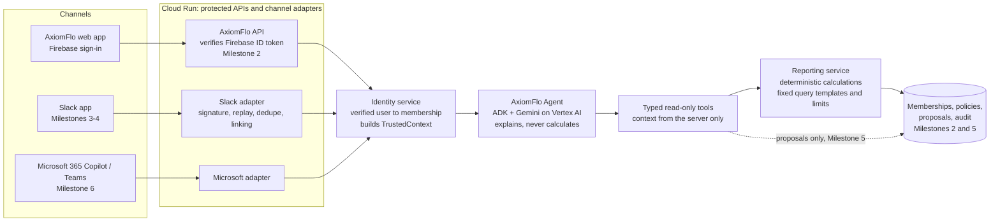

# AxiomFlo Agent architecture

The target design is one shared agent and tool layer that every channel calls. Channel adapters only verify the platform request, map the person to an approved AxiomFlo membership, build a trusted context, call the agent, and format the reply.

## What exists after Milestone 1

| Box | Code | State |
| --- | --- | --- |
| Agent | `backend/axiomflo/agent/` | ADK `LlmAgent`, Gemini model from settings, instructions, figure check |
| Tools | `backend/axiomflo/tools/` | 9 read-only tools (including savings suggestions), context lookup, audit |
| Reporting | `backend/axiomflo/reporting/` | Python port of the web app's calculations, over sample fixtures or a real usage snapshot sent by the API ([usage-snapshot.md](usage-snapshot.md)) |
| TrustedContext | `backend/axiomflo/context.py` | Built by server code; local runs use demo personas |
| Audit | `backend/axiomflo/observability/audit.py` | In memory and Python log; no chat content |
| Everything else | | Later milestones |

## Request flow

1. A channel verifies the person (Firebase token, Slack signature plus linked account, or Entra token) and looks up their membership.
2. It builds a `TrustedContext`: tenant, user, role, teams, channel, how they were verified, and a request ID.
3. `AgentService.ask(context, question)` creates or continues an ADK session under `tenant:channel:user` and binds the context to that session for this turn only.
4. Gemini chooses tools. Each tool looks up the context by session, so the model can't pick a tenant or user, and any made-up arguments are dropped.
5. The reporting service applies tenant and role filters, validates the period, caps result size, and calculates totals with the shared rules.
6. The final answer is checked: any amount or percentage not returned by a tool causes the answer to be withheld.
7. Tool calls and the turn are audited, including the assistant's own token usage under the "AxiomFlo assistant" workload.

## Google platform choices (checked 16 Oct 2026)

- **ADK:** `google-adk` 2.12.0 (Python), pinned in `backend/pyproject.toml`.
- **Naming:** Google's documentation now groups the former Vertex AI agent services under "Gemini Enterprise Agent Platform". The managed ADK runtime (formerly Vertex AI Agent Engine) appears as **Runtime**.
- **Runtime regions:** Asia-Pacific includes `asia-southeast1` (Singapore) and `australia-southeast2` (Melbourne, without Memory Bank). `australia-southeast1` (Sydney) is not listed. [Supported locations for agents](https://docs.cloud.google.com/gemini-enterprise-agent-platform/resources/agent-locations)
- **Gemini models:** availability differs by model and region. Check [Deployments and endpoints](https://docs.cloud.google.com/gemini-enterprise-agent-platform/resources/locations) before choosing. No model ID is hard-coded (`AXIOMFLO_AGENT_MODEL`).
- **Residency:** Google states that regional endpoints alone don't guarantee data residency or in-region ML processing, refers to its separate data residency terms, and advises against the `global` endpoint where processing location matters. The only multi-region endpoints are US and EU, so there is no Australian multi-region option. The pilot should use one named region for Gemini and keep it the same as, or explicitly disclose it alongside, the regions used for Cloud Run (`asia-southeast1` today) and the agent runtime.
- **Not used:** Vertex AI Search, Document AI, BigQuery (no requirement depends on them yet).

## Decisions for later milestones

- **Real data:** the AxiomFlo API and gateway now exist, and real usage records are in Firestore. The agent gets them as a per-question usage snapshot from the API ([usage-snapshot.md](usage-snapshot.md)), never by reading the database. The API's `/api/assistant/*` routes build the snapshot and call the agent's private Cloud Run service ([deploy.md](deploy.md)), and the real AI Cost Assistant page uses them. Next: Slack.
- **Milestone 5:** controls change only through Request → Proposal → Review → Explicit approval on an authenticated AxiomFlo page → Execution → Audit. The model will be able to create a proposal; it will never have a tool that applies one.
